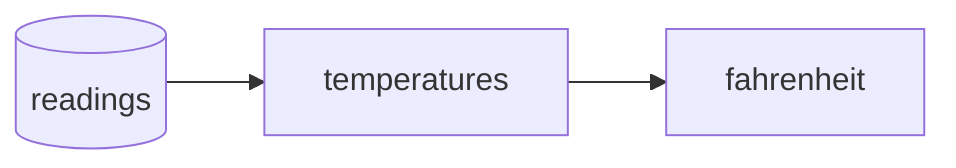

# Your first Pipeline

One Pipe collects readings. Another converts them. A **Pipeline** runs those steps in the right order and gives the workflow a name.

Continue with the two readings from [Incremental sync](incremental-sync.md).



## Add the transformation

Run this Python snippet in the same workspace:

```python
import meerschaum as mrsm

fahrenheit = mrsm.Pipe(
    'sql:local', 'fahrenheit', instance='sql:local',
    columns={'datetime': 'ts', 'primary': 'id'},
    dtypes={'ts': 'datetime'},
    parameters={'sql': """
        SELECT id, ts,
               ROUND(temperature * 9.0 / 5 + 32, 1) AS fahrenheit
        FROM {{ Pipe('sql:local', 'temperatures', instance='sql:local') }}
    """},
)
fahrenheit.register()
```

The `{{ Pipe(...) }}` reference finds the parent's table and tells Meerschaum that **temperatures comes first**.

## Save, preview, run

```bash
mrsm register pipelines climate -i sql:local -c sql:local -m fahrenheit --parents
mrsm plan pipelines climate -i sql:local
mrsm sync pipelines climate -i sql:local
mrsm show data -i sql:local -m fahrenheit
```

`plan` shows the work without moving data. `sync` runs the Pipeline and records its results. You should see **70.7°F** and **71.6°F**.

??? example "Watch the plan become a run"
    <asciinema-player src="/assets/casts/v5-pipeline.cast" size="small" preload="true" rows="20"></asciinema-player>

??? example "Plan and run from Python"
    ```python
    import meerschaum as mrsm

    pipeline = mrsm.Pipeline('climate', instance='sql:local')
    print(pipeline.plan())
    run = pipeline.sync()
    print(run.success, run.inserted, run.updated)
    ```

## Let the graph do the remembering

When you add a reading and run `climate` again, Meerschaum syncs the parent first. The child then uses the data available from its parent. Independent branches can run in parallel.

A saved Pipeline remembers its members and settings. A [job](../reference/background-jobs.md) supplies a schedule. Deleting the Pipeline's saved definition keeps its Pipes and their data.

[See it in the console →](start-api.md){ .md-button .md-button--primary }

For backfills, retries, and larger graphs, continue to the [Pipeline reference](../reference/pipelines/index.md).
