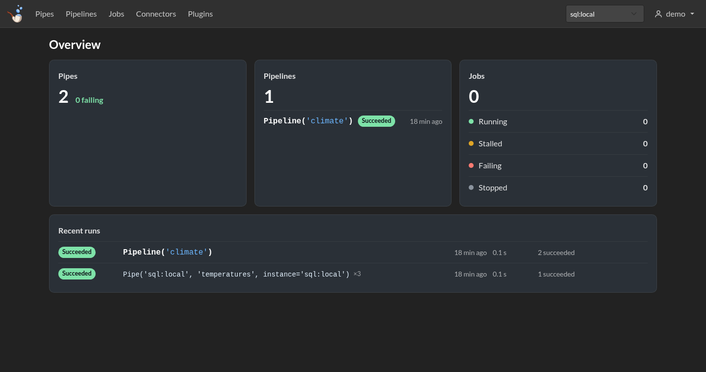
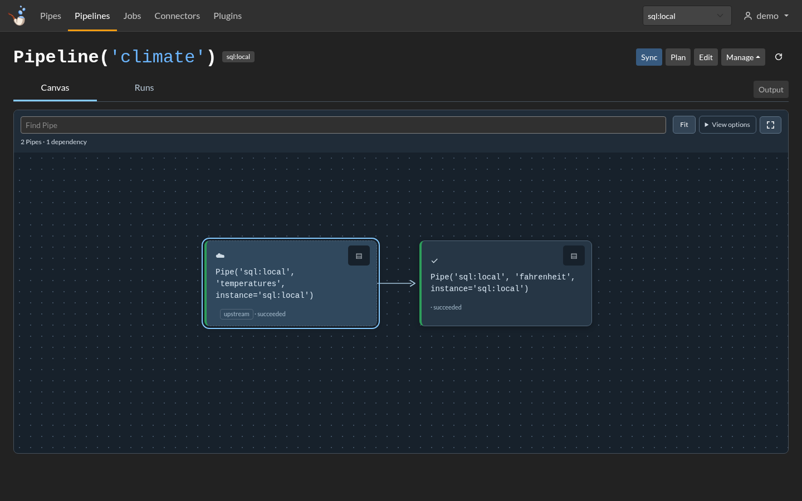

# Explore the console

See the same Pipes and Pipeline from your browser. Continue in the workspace from [Your first Pipeline](pipelines.md).

## Start locally

Install the web console, then start it on loopback:

```bash
python -m pip install --pre 'meerschaum[dash]'
mrsm start api -i sql:local --host 127.0.0.1 --port 8001 --secure
```

Open [localhost:8001/dash](http://localhost:8001/dash). On an empty instance, **Create admin account** sets up its first administrator. Otherwise, sign in with an existing account.

## Find your way around

| Page | Try it |
|---|---|
| **Overview** | See Pipes, Pipelines, jobs, and recent runs together. |
| **Pipes** | Open `temperatures`, preview its rows, and inspect its settings. |
| **Pipelines** | Open `climate` to explore its graph, preview a plan, and follow runs. |
| **Jobs** | Give a command or Pipeline a schedule and read its logs. |
| **Users & Teams** | Add people and choose what they may read or change. |

{ .mrsm-screenshot }

## Follow a Pipeline

Open **Pipelines → climate**. The workspace puts the graph beside the selected Pipe's details. The **Runs** tab shows its history and what each step did.

{ .mrsm-screenshot }

On a phone, switch between **Graph**, **Pipe details**, and **Output** to focus on one thing at a time.

??? tip "Share with a team"
    An administrator can create users and teams. Give readers access to the data they need, and give editors only the actions they need. The console shows controls that match their permissions.

    See [Access and locks](../reference/pipes/access-and-locks.md) and [Console permissions](../reference/api-instance/permissions.md).

Press **Ctrl+C** in the server terminal when you're finished.

[Save a repeatable project →](compose-projects.md){ .md-button .md-button--primary }

For HTTPS and a shared deployment, follow the [API instance guide](../reference/api-instance/index.md).
