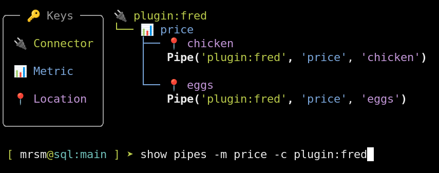
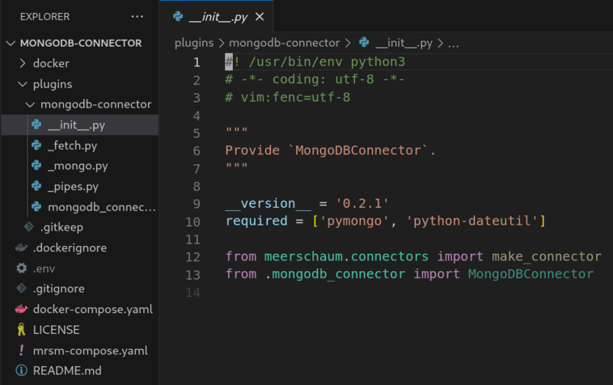
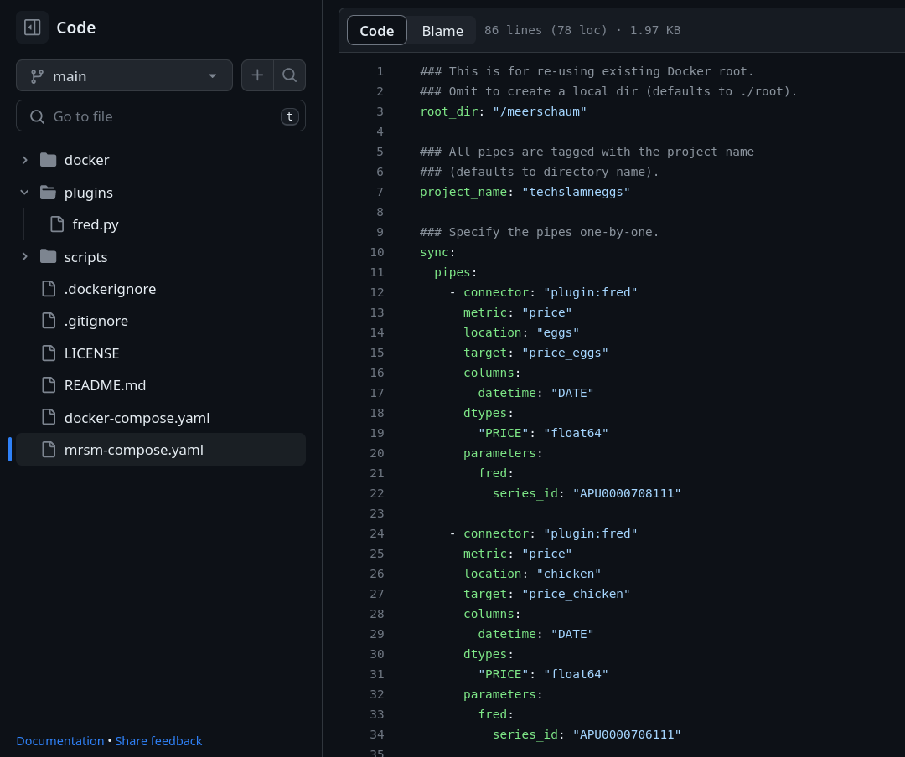
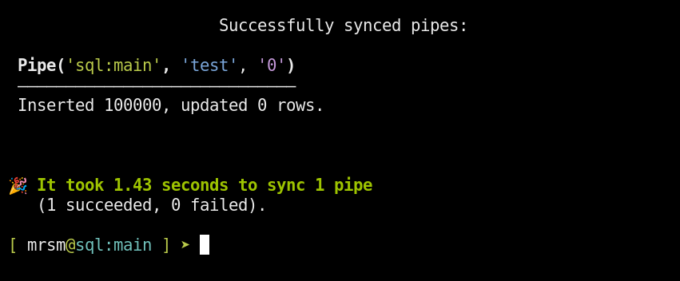

---
hide:
  - navigation
  - toc
---

<div class="mrsm-home" markdown="1">


<p class="mrsm-home-tagline"><em>Out-of-the-box ETL, easy to learn, and a pleasure to use!</em></p>

<div class="mrsm-home-actions">
  <a class="md-button md-button--primary" href="get-started/">Get Started</a>
  <button class="md-button mrsm-install" type="button" data-copy="pip install meerschaum" aria-label="Copy pip install meerschaum"><code>$ pip install meerschaum</code></button>
  <span class="mrsm-copy-status" role="status" aria-live="polite"></span>
</div>

<div class="mrsm-home-grid" markdown="1">

<div markdown="1">

## What is Meerschaum?

Meerschaum turns queries and Python functions into named data streams called **[Pipes](reference/pipes/index.md)**. Register a source, sync it, and query the results from your database, Python, or the web console.

## Why Meerschaum?

**Incremental updates.** Fetch the new and changed rows. Meerschaum handles deduplication, upserts, schema changes, and scheduling.

Group related Pipes into a **[Pipeline](reference/pipelines/index.md)** to run transformations in dependency order and keep their history.

[Create your first Pipe →](get-started/bootstrap.md)

</div>

<div class="mrsm-home-demo" markdown="1">

<asciinema-player src="/assets/casts/v5-first-pipe.cast" title="Create and sync a Pipe" preload="true"></asciinema-player>

<p class="mrsm-caption">Genuine CLI recording from 5.0.0rc16. Playback pauses are extended for reading.</p>

</div>

</div>

## Features

<div class="mrsm-home-grid" markdown="1">

<div markdown="1">

### Organize ETL into Pipes

Tag streams, inspect their data, and reuse them in transformations.

{ loading=lazy }

### Ingest from any source

A [Python plugin](docs/python/plugins.md) can return rows from a file, service, or device. A [Rust plugin](docs/rust/plugins.md) adds native actions, sources, routes, and more.

{ loading=lazy }

### Keep projects reproducible

[Meerschaum Compose](reference/compose.md) keeps Pipe definitions, jobs, and configuration beside your code.

{ loading=lazy }

</div>

<div markdown="1">

### Transform in SQL

When source and destination share a SQL instance, transformations can run in place. Larger transfers use chunks and concurrent workers.

{ loading=lazy }

### Use it from your code

```python
import meerschaum as mrsm

pipe = mrsm.Pipe(
    'plugin:manual', 'readings',
    instance='sql:local',
    columns={'id': 'id'},
)
result = pipe.sync([{'id': 1, 'temperature': 21.5}])
print(result.success, result.inserted)
print(pipe.get_data(as_docs=True))
```

Start with the [Python](docs/python/index.md) or [Rust](docs/rust/index.md) guides, then follow the full API references.

### Run and observe

Give work a [schedule](reference/background-jobs/schedules.md), manage it in the [console](reference/api-instance/web-console.md), and chart sync metrics in [Grafana](reference/stack/index.md#built-in-performance-dashboards). Teams, permissions, and locks control shared access.

[Explore the console →](get-started/start-api.md)

</div>

</div>

## Video Tutorials

<div class="mrsm-home-grid mrsm-home-videos">
  <iframe width="672" height="378" src="https://www.youtube.com/embed/VFFWe7B33Io" title="Getting started with Meerschaum" loading="lazy" allow="accelerometer; clipboard-write; encrypted-media; gyroscope; picture-in-picture" allowfullscreen></iframe>
  <iframe width="672" height="378" src="https://www.youtube.com/embed/t9tFD4afSD4" title="Building data pipelines with Meerschaum" loading="lazy" allow="accelerometer; clipboard-write; encrypted-media; gyroscope; picture-in-picture" allowfullscreen></iframe>
</div>

<div class="mrsm-home-grid" markdown="1">

<div markdown="1">

## Support the Project

Meerschaum is open source. Help with an [issue or contribution](https://github.com/bmeares/Meerschaum), or support development through [GitHub Sponsors](https://github.com/sponsors/bmeares).

</div>

<div markdown="1">

## Consulting Services

Need help with your data pipelines? Contact Bennett Meares on [LinkedIn](https://linkedin.com/in/bennettmeares).

</div>

</div>

</div>
