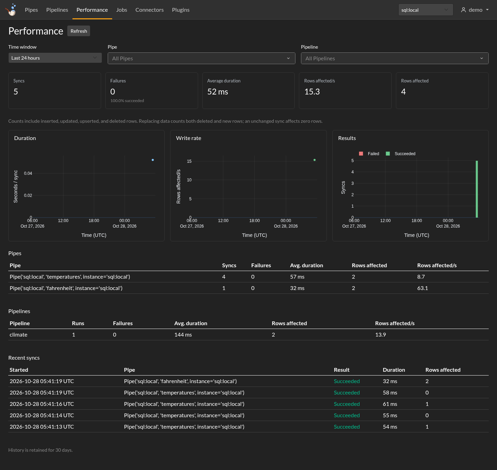

# Sync metrics

Find slow or failing syncs, and see how much data each Pipe or Pipeline changes.

## In the console

Open **Performance** in the navigation, or choose **View performance** on the Overview card. Pick a time window, then narrow it to a Pipe or Pipeline.

- **Duration** shows the average time per sync.
- **Write rate** shows **rows affected/s**.
- **Results** shows successful and failed syncs over time.

The tables below compare Pipes and Pipelines and list recent syncs. Hover over a chart for its values; drag to zoom and double-click to reset. **Refresh** reads the latest measurements.

{ .mrsm-screenshot }

**Rows affected** counts inserted, updated, upserted, and deleted rows. Replacing data counts the deletion and the new rows. An unchanged sync affects zero rows, even when it spends time fetching or checking data.

## From Python

Read measurements from your instance:

```python
import meerschaum as mrsm

metrics = mrsm.get_engine_metrics(instance='sql:local', pipeline='climate')
summary = metrics['summary']
print(summary['syncs'], 'syncs;', summary['failed'], 'failed')
print(summary['avg_duration_seconds'], 'seconds per sync')
```

Leave out `pipeline` for every Pipe, or pass a `Pipe` as `pipe=`. Use UTC datetimes for `begin=` and `end=` to choose a window.

??? info "History, limits, and access"
    - History is retained for **30 days**. The default query covers the last 24 hours.
    - Native queries aggregate at most **5,000** detailed sync records; the console requests **1,000**. The page says when its result is limited. Choose a shorter window for a closer look.
    - Capture runs in the background and is best effort. Queue or database pressure can drop a measurement without failing the sync.
    - The console and HTTP API filter by your current Pipe, Pipeline, and team access before calculating results. An access change starts a new visible history segment.
    - Clients from before **5.0.0rc16** do not backfill detailed sync history.
    - The local Python SDK uses the instance's credentials. A hosted interface must supply its own access checks.

## In Grafana

The [Stack](../stack.md) dashboards show the same affected-row, duration, and failure measurements.

Grafana reads directly with the database credentials configured for its data source. Its visibility follows those database permissions; the console and HTTP API apply their Pipe and team access rules.

[Explore the console →](web-console.md)
