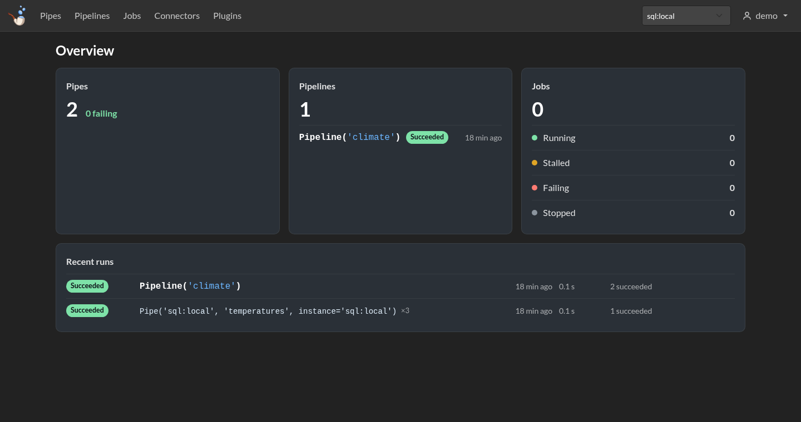

# 🎛️ Web Console

The Web Console is a graphical UI for your [API instance](/reference/api-instance/). Start the server and open [http://localhost:8000](http://localhost:8000):

```bash
pip install 'meerschaum[dash]'
mrsm start api
```

!!! note "Included in `[full]` and Docker"
    The Dash console ships in `meerschaum[dash]`, `meerschaum[full]`, and the `full` Docker image. Standalone Rust installs serve the API, `/docs`, `/engine/*`, MCP, and web terminal without `/dash`. Pass `--no-dash` to disable it.

{ .mrsm-screenshot }

## Navigation

Every console page shares the same top bar:

| Control | What it does |
|---|---|
| **Logo** | Returns to [Overview](#overview). |
| **Core tabs** | **Pipes**, **Pipelines**, **Performance**, **Jobs**, **Connectors**, **Plugins**, and **Terminal** (hidden when unauthorized). |
| **Pages** | Plugin `@web_page` links filtered by allowed plugins; multi-page groups nest cleanly with page counts. |
| **Team switcher** | Lets admins and multi-team members preview the console as a specific team (or **Everyone**) without escalating permissions. |
| **Instance** | Switches the active instance across pages (override in the URL with `?instance=sql:other`). |
| **User menu** | **Users & Teams**, **Tokens**, **Settings**, **Grafana**, and **Sign out**. |

Plugin pages can opt into this bar with `@web_page(..., navbar=True)`—see [Web Pages and Routes](../plugins/web-pages.md).

## Signing in

On an empty instance, the login screen shows **Create admin account** so the first user is an administrator. Self-registration is off by default (`api:permissions:registration:users: false`).

- Sessions last 30 days by default (`api:cache:session_expires_minutes`).
- Pass `mrsm start api --no-auth` for local, password-free testing.

## Overview

`/dash` refreshes every 30 seconds with live tiles for **Pipes**, **Pipelines** (24h hourly runs), **Jobs & Next runs**, **Recent runs**, and 24h **Performance**.

## Performance

`/dash/performance` charts duration, **rows affected/s**, and failures by Pipe or Pipeline, plus an **Engine** breakdown (**Runs**, **Freshness**, **Backlog**, **Nodes**). See [Sync metrics](sync-metrics.md).

## Terminal

**Terminal** (`/dash/terminal`) pairs a command builder with an interactive web terminal (requires `webterm:use`; **Exec** also needs `actions:execute`):

- **Admins** get a full `mrsm` shell.
- **Non-admins** get a restricted `mrsm` shell checked against `POST /execute`—no raw shell escapes, Python, or editors ([Who may run actions](permissions.md#who-may-run-actions)).
- **Isolated teams** with `plugins_write` get a sandboxed team terminal on supported Linux hosts ([Commands of a team that runs code](teams.md#commands-of-a-team-that-runs-code)).

!!! danger "⚠️ Never combine open registration with Operator"
    Do not pair `api:permissions:registration:users: true` with `api:permissions:default_role: operator` on an exposed server. Use `mrsm start api --secure` or `--private`.


Click **Exec** to run a command in the terminal, or trigger async **Manage** / Pipeline actions that stream live logs and engine events.


Tabs run on a private `tmux` server separate from `~/.tmux.conf`:

```yaml
# mrsm edit config api
api:
  webterm:
    tmux:
      enabled: true
      session_suffix: _mrsm
      config: ~/.config/meerschaum-tmux.conf  # Optional
```

!!! note "Terminals without tmux"
    If an isolated team has `plugins_write` on a host where Unix sockets are not denied, terminals fall back to single-tab shells ([Terminals without tmux](teams.md#terminals-without-tmux)).

## Pipes

**Pipes** (`/dash/pipes`) lists readable [pipes](/reference/pipes/) with shareable URL filters and **All / Mine / My teams** scopes.


| Column | Shows |
|---|---|
| **Pipe** | Connector, metric, location, and lock badge when [locked](#pipe-access-and-locks). |
| **Rows** | Exact count (SQLite, DuckDB, <100k rows) or fast DB estimate (`~1.2M`). |
| **Sync time** | Latest UTC datetime or integer watermark. |
| **Status** | Last sync outcome across CLI, jobs, Pipelines, API, and Python. |
| **Team / Tags / Jobs** | Visibility badge, [tags](/reference/pipes/tags/), and matching [jobs](/reference/background-jobs/). |

Click any pipe to inspect **Overview**, **Data** (CSV export + JSON sync), **Parameters**, **Definition**, **Lineage**, and **Runs**, or trigger **Sync**, **Verify**, **Edit**, and **Manage**.


Click **New pipe** (`/dash/pipes/new`) to bootstrap a pipe with a 10-row SQL **Preview** (requires `pipes:register` and `pipes:define_sql`).

### Pipe access and locks

From a pipe's **Manage** menu, owners, team managers, and admins can set:

- **Access…:** Visibility (**Its team**, **Private**, **Everyone**) and edit mode (**Anyone who can see it** vs. **Owner and team managers**).
- **Locks…:** Block **Edit parameters**, **Sync**, **Clear rows**, **Drop or rebuild**, or **Delete** everywhere—including CLI, Python, jobs, and admins.

See [Teams, Access and Locks](/reference/actions/teams-and-access/).

## Connectors, Pipelines & Plugins

- **Connectors (`/dash/connectors`):** Lists visible connectors with passwords masked (`••••••`). Admins can inspect settings and click **Test connection**.
- **Pipelines (`/dash/pipelines`):** Visual DAG **Canvas** and **Runs** timeline ([Visualization](/reference/pipelines/visualization/#running-a-pipeline-in-the-console)).
- **Plugins (`/dash/plugins`):** Browse **Installed** and **Repository** plugins, inspect source, edit/upload via **New plugin**, publish, and install/uninstall as tracked runs.


## Jobs

**Jobs** (`/dash/jobs`) groups visible [background jobs](/reference/background-jobs/) by state and refreshes every 15 seconds (**Runs** at `/dash/runs` tracks console-triggered runs):

| Status | Meaning |
|---|---|
| **Running** | Healthy and running. |
| **Stalled** | No lap completed for 3× its interval (or 1h for `--listen`). |
| **Failing** | Consecutive failed laps while running. |
| **Paused / Stopped / Failed** | Paused, stopped cleanly, or exited with an error. |

Use a row's **⋮** menu to **Start**, **Pause**, **Stop**, **Restart**, **Delete**, **View logs**, or **Download logs**, or click **New job** to create one-off, scheduled (`-s`), or looping (`--loop`) jobs.

## Users, Teams & Tokens

- **Users & Teams (`/dash/users`, `/dash/teams`):** Manage users, roles, password resets, and teams (follows the active team in the top bar; pick **All teams (Admin)** for global admin).
- **Tokens (`/dash/tokens`):** Create, edit, invalidate, or delete API [tokens](/reference/api-instance/tokens/) and generate ready-to-paste MCP client snippets.

| Capability | Viewer | Editor | Operator | Team manager | Admin |
|---|---|---|---|---|---|
| Browse Pipes, Pipelines, Jobs, Plugins, Connectors | ✓ | ✓ | ✓ | ✓ | ✓ |
| Terminal & Exec | | | ✓ | (by role) | ✓ |
| Register, edit, and sync pipes | | ✓ | ✓ | ✓ | ✓ |
| Access… & Locks… | own | own | own | team's | all |
| Users & Teams emails / Add users & teams | | | | team emails | all / ✓ |


## Dash MCP server

Plotly Dash can expose the console's component tree at `/dash/_mcp` to help AI agents build [web page plugins](../plugins/web-pages.md). It is separate from Meerschaum's `/mcp` server and disabled by default:

```yaml
# mrsm edit config api
api:
  dash:
    mcp:
      enabled: true   # requires dash>=4.3.0
```

!!! danger "Development only—do not enable on a public instance"
    `/dash/_mcp` runs outside FastAPI scope checks and is limited to layout introspection unless callbacks explicitly opt in with `mcp_enabled=True`. Use [`/mcp`](../mcp/index.md) for data access.
