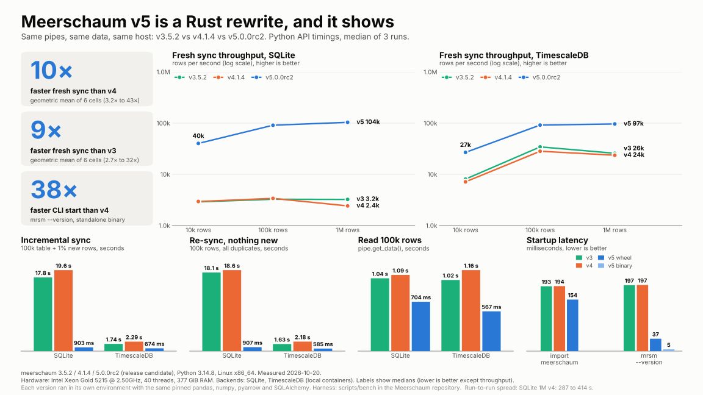

# Measured performance

Meerschaum 5 moves the data core to Rust. This comparison follows the same workloads across **3.5.2**, **4.1.4**, and **5.0.0rc2**.

[{ .mrsm-benchmark }](../assets/bench/meerschaum-v3-v4-v5.svg)

[Open full-size SVG](../assets/bench/meerschaum-v3-v4-v5.svg) · [Download PNG](../assets/bench/meerschaum-v3-v4-v5.png)

## A few results

In this run, the Python API synced one million rows to TimescaleDB in **10.36 seconds**, compared with **42.25 seconds** in v4 — about **4.1× faster**.

| Workload | v4.1.4 | v5.0.0rc2 |
|---|---:|---:|
| TimescaleDB: sync 1 million rows | 42.247 s | 10.357 s |
| TimescaleDB: read 1 million rows | 3.822 s | 1.409 s |
| SQLite: add 1% new rows to a 100,000-row table | 19.569 s | 0.903 s |
| Wheel CLI: `--version`, including startup | 0.197 s | 0.037 s |

## How it was measured

Recorded **20 October 2026**, using Python 3.14.8 on Linux x86_64, an Intel Xeon Gold 5215, 40 logical CPUs, and 377 GiB RAM. Values are medians of three runs after warm-up. Databases were local; the test adds no network delay. The Python API, wheel CLI, and standalone binary are labeled separately in the chart.

These results describe the measured release candidate and workloads. Your database, data types, machine, and network all affect the outcome. The v4 SQLite million-row sync varied substantially between runs; the chart and report retain that variation.

??? info "Source data and reproduction"
    The image was generated directly from the recorded medians. No final-release measurements have been substituted.

    - [Recorded results and methodology](https://github.com/bmeares/Meerschaum/blob/2ce8b2bb39530ce1415ccbbe20cc76c75c008379/scripts/bench/results/2026-10-20-v3-v4-v5.md)
    - [Raw measurements](https://github.com/bmeares/Meerschaum/blob/2ce8b2bb39530ce1415ccbbe20cc76c75c008379/scripts/bench/results/2026-10-20-v3-v4-v5.json)
    - [Benchmark harness](https://github.com/bmeares/Meerschaum/tree/2ce8b2bb39530ce1415ccbbe20cc76c75c008379/scripts/bench)
    - [Chart generator](https://github.com/bmeares/Meerschaum/blob/2ce8b2bb39530ce1415ccbbe20cc76c75c008379/scripts/bench/plot_v345.py)

[Try the same incremental workflow →](../get-started/incremental-sync.md)
