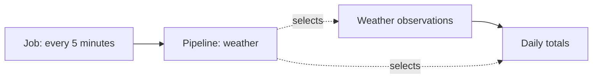

# Pipelines in Compose

Declare what runs in `pipelines:`. Use `jobs:` to decide when it runs.

```yaml
pipelines:
  weather:
    description: Weather observations and daily totals.
    pipes:
      - {connector: plugin:noaa, metric: weather, location: atlanta}
      - {connector: sql:local, metric: daily, location: atlanta}
    defaults: {workers: 1}

jobs:
  weather: sync pipelines weather --loop --min-seconds 300
```

The members must be defined under `pipes:` or already registered. Dependencies
come from their Pipe parameters and `{{ Pipe(...) }}` references.



## Preview and apply

```bash
mrsm compose explain
mrsm compose up --dry
mrsm compose plan pipelines weather
mrsm compose sync pipelines weather
```

`explain` reads definitions without creating a root or writing registrations.
`up --dry` updates Pipe and Pipeline registrations without starting jobs or syncing
data. `up` and `run` also apply Pipeline definitions before executing their work.

## Definition fields

| Field | Default | Meaning |
|---|---|---|
| Mapping key | Required | Instance-local Pipeline name. |
| `pipes` | Required | Nonempty list of exact member keys. |
| `instance` | Project instance | Registry that stores this definition. |
| `description` | Empty | Short explanation of the work. |
| `parents`, `children` | `false` | Include dependencies or descendants; a nonnegative integer limits depth. |
| `defaults` | `{}` | Execution options such as `workers`, `retries`, and `chunksize`. |

A member has `connector`, `metric`, optional `location`, and optional `instance`.
Omitting `location` means the null location. Its instance defaults to the project's
instance, including when the Pipeline uses a separate registry.

??? example "A registry separate from the data"

    ```yaml
    pipelines:
      reporting:
        instance: sql:registry
        pipes:
          - {connector: sql:source, metric: daily, instance: sql:warehouse}
    ```

Membership is explicit. Lists of keys, live filters, and nested Pipe parameters
are rejected here. Put Pipe definitions under `pipes:` and schedules in `jobs:`.
A Pipe may belong to several Pipelines.

??? info "Updates and ownership"

    Compose owns a definition by its project name and registry. A conflicting
    declaration or an existing Pipeline owned elsewhere fails before registration
    changes. Included projects cannot declare the same name on the same registry.

    Applying identical membership and settings keeps the revision. An update keeps
    the identity, layout, access, locks, and previously approved tag associations.
    Concurrent edits are checked under the shared registry lease.

    Applying a Pipeline does not add membership tags. Use `analyze pipelines` to
    review them. Removing a declaration or running `down` leaves the saved Pipeline;
    use `delete pipelines NAME` to remove it through the normal Job checks.
    Membership does not grant ownership of a member's data.

Listeners, API servers, backups, verification, and custom actions remain ordinary
Jobs. A Pipeline groups Pipe syncs; it does not replace action chains.
