# 📊 Visualization

The engine emits one typed event per transition, and everything you see is drawn from that stream or from the recorded run:

`run_started`, `node_planned`, `node_started`, `chunk_started`, `chunk_finished`, `node_finished`, `node_failed`, `node_skipped`, `node_rebuild_pending`, `watermark_advanced`, `stream_flushed`, `children_triggered`, `stream_restarted`, `run_finished`.

## Running a Pipeline in the console

Open **Pipelines**, then choose a saved Pipeline.

| View | What it shows |
|---|---|
| **Canvas** | Pipe relationships, without reading data or planning a sync. |
| **Runs** | Recorded runs on one timeline. Select a run, then choose **Timeline** or **Table**. |
| **Plan** | What the next sync would do, with its reasons and bounds. |

The canvas shows dependencies; the Gantt chart shows actual execution. Independent branches
can overlap when the run has enough workers. A one-worker run stays sequential.

### Related pipes

Enable **View options → Show related pipes** to see ancestors and descendants outside the
Pipeline. These cards are dimmed and marked **Not included**. This setting only changes the
view; it does not change membership or saved traversal settings.

```mermaid
flowchart LR
    stream[Incoming data] --> clean
    subgraph selected[Pipeline]
        clean[Clean] --> report[Report]
    end
    clean --> export[Export]
    style stream fill:#303841,stroke:#8093a4,stroke-dasharray:5
    style export fill:#303841,stroke:#8093a4,stroke-dasharray:5
```



Choose **Edit**, inspect a related Pipe, then **Add to Pipeline**. Review the draft and
**Save** to persist it. A **Shared** badge names other visible Pipelines in the same registry
that already include the Pipe. Shared membership is allowed; the engine's leases still apply.

??? tip "Canvas controls and output"

    Drag the background to pan, or pinch with two fingers to zoom. **Fit**, **Center selected**
    and **Fullscreen** keep large graphs usable on a phone. Zoom and pan stay in your browser;
    shared Pipe positions are saved in Edit mode.

    Select a card to inspect its query, parameters, dependencies or recent syncs. These sections
    load separately. **Show resolved query** changes the preview without changing stored SQL.

    **Sync this Pipe** launches that Pipe only; its sync options can include parents or children.
    The output icon follows its events. **Sync** in the Pipeline header runs the saved Pipeline.
    **Cancel sync** stops only the selected execution. Completed runs remain in **Runs**.

## 🖥️ In the terminal

`mrsm sync pipes` prints each node's result and a run summary. Graph selections also show the
run as it goes (see [Live view of a run](#live-view-of-a-run) below). `mrsm show run <id>` reads the recorded run; actual
elapsed time and observed execution intervals are the primary Timeline view. `plan pipes` and
`plan pipelines` explain the next actions and bounds independently of that execution history.
`--nopretty` prints machine-readable plan and run information.

??? example "Terminal views and controls"

    ### Live view of a run

    `sync pipes` with `--parents`, `--children` or `--resume`, and `sync pipelines`, keep a small
    live region at the bottom of the terminal while the run goes on. It has a header and one row per
    running Pipe:

    ```text
      · Pipe('sql:main', 'daily') incremental: new rows upstream
      ✔ Pipe('sql:main', 'raw') +1204 ins ~0 upd +0 ups
    ⠹ Syncing 1/4 pipes · 2 running  12s  w: watch
      Pipe('sql:main', 'daily')   incremental  3/10 chunks  +3.6k ins ~12 upd +0 ups  1.2k rows/s  8.4s
      Pipe('sql:main', 'weekly')  backfill · attempt 2  1 chunk  +0 ins ~0 upd +0 ups  1.1s
    ```

    - A row shows the action, the chunks done (`3/10 chunks` when the plan knows the total, else the
      chunks fetched so far), the rows inserted / updated / upserted so far, the throughput, the
      attempt when it is not the first (`retrying` between attempts) and the time the attempt has run.
    - Above the region, into the scrollback: each plan decision (`·`), each failed attempt that will
      be retried (`↻`), and one permanent line per finished Pipe: `✔` with its row counts, `✘` with
      the error's first line, `○` for a skipped Pipe or a pending rebuild. The run summary and the
      Gantt chart follow when the run ends, and the region is gone.
    - The region redraws about ten times a second with cursor movement (no alternate screen, so the
      scrollback keeps everything). It fits the terminal: details drop out on a narrow one, the rows
      of a short one end with `… and N more running`, and a resized terminal is redrawn at the new
      size. Other output (warnings, plugin output) is printed above it.
    - Typing is not echoed while the region is shown. Press **`w`** to open the full-screen run
      monitor of this run; leaving it (or quitting it) brings the inline view back, and the run keeps
      going either way. Plugin output written while the monitor is open is printed into the
      scrollback when it closes. **Ctrl-C** cancels the run as before. **Ctrl-Z** erases the region
      and gives the shell a normal terminal; `fg` draws it again.
    - A Python plugin can still ask for input (`input()`, a prompt without a newline): the region
      steps aside and typing is echoed until the plugin prints a full line again.
    - Every event of the run reaches the view (none is dropped while the terminal is busy). A Pipe
      whose last line never printed (the run was cut short) gets it from the run's results at the
      end.
    - `sync pipes --loop` and `--listen` show the same running rows under each lap's usual output.

    The region needs a terminal that takes ANSI cursor movement. `--nopretty`, `--debug`, output to
    a pipe or file, `formatting:ansi: false` and `TERM=dumb` keep the plain output: one
    `▶` / `✔` / `✘` / `○` line per Pipe on a terminal without ANSI, and none at all with
    `--nopretty` or when piped.

    Scheduling forecasts can use a per-action historical moving average (alpha 0.3), other successful
    action history, or `system.engine.default_duration_seconds` (30 seconds). These estimates omit
    worker contention and can greatly exceed a fast first run. They are planning hints; the console
    therefore does not overlay them on the actual-time chart.

    `mrsm show graph` draws a selection as a top-down tree (a pipe with several parents is drawn once, under the first parent the walk reaches, and referred to elsewhere):

    ```text
    Pipe graph on sql:local: 4 pipes, 4 edges, 1 root, depth 3

    ● Pipe('sql:local', 'a')
    ├── ◆ Pipe('sql:local', 'b')
    │   └── ○ Pipe('sql:local', 'd')  (2 parents)
    └── ◆ Pipe('sql:local', 'c')
        └── ↗ Pipe('sql:local', 'd') (shown above)

    ● root   ◆ has children   ○ leaf   ↗ shown above
    ```

    Pipes use the colors `Pipe(...)` has in `show pipes` (connector, metric, location, instance); the guides and notes are dim. `★` marks the pipes you selected, `┄┄` in place of `──` an edge that exists only because of a `{{ Pipe() }}` reference, and `lookback`, `lookahead` and `axis` of an edge follow the pipe. A cycle (flat selections only; a `--parents` / `--children` selection that contains one fails with the cycle path) is drawn with its real edges, its members marked `⟲`, and a `⟲ cycle: a → b → a` note; the JSON gains a `cycles` key. Unconnected pipes are listed together at the end, and a pipe with more than 12 children collapses to `… and N more children` (`--full` lists them all; the line says how many hidden children have descendants of their own). Lines are cut to the terminal width, `formatting:unicode: false` gives an ASCII tree, and colors appear only on a terminal.

    `show graph` accepts the usual filters plus `--parents` and `--children`. `mrsm show runs [--last N]` lists the recorded runs, newest first:

    ```text
    run                         started (UTC)        status     wall  ok/nodes  targets
    01M4VPBBSG8NMTDT2NJYE98D2Q  2026-10-13 22:32:53  succeeded  0s    3/3       Pipe('sql:local', 'daily')
    ```

    `--nopretty` prints JSON for `plan pipes`, `show graph`, `show runs` and `show run`.

    !!! note "Inline and full-screen"

        The live region is inline: progress rows while the run is going and the Gantt chart at the end, all in the scrollback. Press `w` during a run for the full-screen monitor.

## 🌐 In the web console

Start `mrsm start api` and open [Web Console](../api-instance/web-console.md).
The [Canvas and Runs views](#running-a-pipeline-in-the-console) keep their state when switched.
Live runs follow the server's event stream; recorded history stays available after a restart.

## 🐍 Live events in Python

`Pipeline.sync()` and `pipe.sync(parents=..., children=...)` take an **`on_event`** callable. It receives every event of the run as it happens, in order, as a plain `dict`:

```python
import meerschaum as mrsm

def on_event(event):
    if event['event'] == 'node_finished':
        print(event['pipe_ref'], event['result']['inserted'], 'inserted')
    elif event['event'] == 'chunk_finished':
        print('  chunk', event['chunk'], event['begin'], event['end'])

run = mrsm.Pipeline(pipe, parents=True).sync(on_event=on_event)
run = pipe.sync(children=True, on_event=print)
```

??? info "Event fields and callback behavior"

    Every event has the same envelope, and the event's own fields at the top level:

    | Key | Type | Meaning |
    |---|---|---|
    | `event` | `str` | The event name (one of the names at the top of this page). |
    | `run_id` | `str` | The run (the same as `run.run_id`). |
    | `seq` | `int` | Emission order within the run, from 0. |
    | `ts` | `datetime` | When it happened (timezone-aware, UTC). |
    | `pipe_ref` | `str` or `None` | `instance|connector|metric|location` of the node; `None` for `run_started` / `run_finished`. |

    | Event | Fields |
    |---|---|
    | `run_started` | `nodes`, `workers`, `targets` |
    | `node_planned` | `action`, `reason`, `provisional` (sent again when a node is re-planned after its parents) |
    | `node_started` | `action`, `attempt` |
    | `chunk_started` | `chunk`, `begin`, `end`, `source` (`window` or `fetch`), `rows`, `total` |
    | `chunk_finished` | `chunk`, `success`, `message`, `source`, `rows`, `inserted`, `updated`, `upserted`, `begin`, `end`, `duration_ms` |
    | `node_finished` | `result` (`success`, `message`, `inserted`, `updated`, `upserted`, `deleted`, `changed_intervals`, `duration` (seconds), `begin`, `end`) |
    | `node_failed` | `error`, `traceback`, `attempt`, `will_retry` |
    | `node_skipped` / `node_rebuild_pending` | `reason` |
    | `watermark_advanced` | `from`, `to` |
    | `stream_flushed` | `rows`, `bytes`, `trigger`, `success`, `begin`, `end`, `inserted`, `updated`, `upserted`, `message` |
    | `children_triggered` | `run_id`, `nodes`, `held`, `flushes` |
    | `stream_restarted` | `error` |
    | `run_finished` | `success`, `message` |

    A bound (`begin`, `end`, `from`, `to`) is `{"Datetime": "2024-01-01T00:00:00Z"}` or `{"Int": 5}`; fields that do not apply are absent. New fields may be added; read them with `event.get(...)`.

    **Threads and the GIL.** The callback runs on the thread that called `sync()`, between events. The sync work runs on the engine's own threads without holding the GIL, so other Python threads keep running and a slow callback only delays later callbacks: events queue up and none is dropped.

    **Errors.** If the callback raises an `Exception`, the run is **not** stopped: the exception is reported once with `warnings.warn` (including its traceback), the callback receives no further events, the run result carries it as `run.callback_error`, and `run.warnings` gets a line about it. A `KeyboardInterrupt` (raised in the callback, or CTRL-C while the run waits) **cancels** the run: in-flight node syncs are dropped as if the process had crashed (the engine's write ordering keeps every table and cursor consistent, and the next run picks up where it stopped), and the `KeyboardInterrupt` propagates.

    `run.events()` (and `Pipeline.get_events(run_id)`) still read a run's *persisted* events back from the instance after the fact, at the granularity of `system.engine.events` (every event by default). Each row has the same keys as a live event (the envelope plus the event's own fields at the top level, so `event['result']['inserted']` works on both) and also `payload`, the event's own fields as one dict; its `ts` is the ISO 8601 text the instance stored rather than a `datetime`.

## 📡 Following a run over HTTP

An API server streams any run whose history it can read as [Server-Sent Events](https://developer.mozilla.org/en-US/docs/Web/API/Server-sent_events):

```text
GET /engine/runs/{run_id}/events/stream[?instance_keys=sql:main][&after_seq=4][&wait=30][&idle_timeout=900]
```

Each engine event is one SSE event: `event:` is its name, `id:` its `seq` and `data:` the same JSON as the `on_event` dicts above (the envelope plus the event's own fields; `ts` is an ISO string, and a `node_finished` result's `duration` is `{"secs": 0, "nanos": 49133000}`, which Python reads as `0.049133` seconds). The stream always ends with a terminal event: `run_finished`, or `run_closed` when the run will not send one (see below).

```text
event: chunk_finished
id: 4
data: {"run_id":"pipeline-2026-…","seq":4,"ts":"2026-01-01T00:00:04Z","pipe_ref":"sql:main|sql:main|daily|None","event":"chunk_finished","chunk":0,"success":true,"message":"…","source":"fetch","rows":5,"inserted":5,"updated":0,"upserted":0}
```

- **Resuming.** Reconnect with `Last-Event-ID: <seq>` (browsers' `EventSource` does this by itself) or `?after_seq=<seq>` to continue after that event.
- **Where events come from.** Runs the server executes itself (`POST /actions/sync`, the MCP action tools) and engines on an `api:` instance that flush their events to it are delivered as the events happen. Otherwise the server tails the run's persisted events (`mrsm_engine_events` on the instance that keeps its history: the server's own, or `instance_keys`) every half second, so it follows runs of jobs and of other processes sharing the instance.
- **Runs that never finish.** A run whose process was killed sends no `run_finished`. The stream then ends with a synthetic `run_closed` event (no `id:`; its `seq` repeats the last event's) whose `reason` says why, and which also carries `finished` (whether the run's record was closed), `success` and `message` from the run's record:

    | `reason` | When |
    |---|---|
    | `interrupted` | The run's record was closed without `run_finished` (a few seconds after it closed). |
    | `holder_gone` | The run's holder (`mrsm:<host>:<pid>`) names the server's machine and a process that is no longer running, and the run has sent nothing for 2 minutes. A run on another machine or container (or one recorded by a 5.0 release candidate as `mrsm:<pid>`) is never closed this way; it ends as `idle` instead. |
    | `idle` | The run has sent nothing for `idle_timeout` seconds (default 900, from 10 to 86400). The run may still be going: a single long chunk sends nothing until it finishes. |

- **Waiting for a run.** `wait` (seconds, at most 60) keeps the request open until a run that was just launched appears; without it an unknown run is a `404`.
- **Authorization** is that of `GET /engine/runs`: the `pipes:read` scope, by bearer token or the console's session cookie. A run the server cannot read the history of is an error (`500`), not a `404`. Comments (`: keep-alive`) every 15 seconds keep proxies from closing a quiet stream; with nginx in front, the server already sends `X-Accel-Buffering: no`. Open streams are bounded like log streams (`api:permissions:log_streams`).
- **Order.** Events are delivered once, in `seq` order. With `system.engine.events: nodes` the chunk events of a run in another process are not persisted, so when the stream meets a missing `seq` it waits up to a second, once for every event it has received by then, before moving on: the delay does not add up across gaps.
- **Limits.** Open streams count against `api:permissions:log_streams` (`max` for the server, `per_user` per user or token). Waiting for a run (`wait`) does not hold a stream. On a `--no-auth` server, streams are counted per console session, and requests without a console cookie count only against `max`.

From Rust, `APIConnector::follow_engine_run(run_id, after_seq, instance_keys)` returns the same events as an async stream. `follow_engine_run_with(run_id, FollowRunOptions { wait, idle_timeout, .. })` sets the other parameters. The client resumes a dropped connection with `Last-Event-ID`. It retries a failed reconnect (a restarting server, a `429` or a `5xx`) with a growing pause, up to 5 failures in a row, and ends the stream after `run_finished` or `run_closed` (`EngineRunEvent::is_terminal`).


After selecting a saved Pipeline, **Run now** opens its command output directly in the
canvas. **View output** reopens that execution's retained logs after closing the drawer.
Use node output icons for individual Pipe executions and **Runs** for historical timelines.

**Manage**, beside the Pipeline selector, contains definition and schedule controls.
Deleting a Pipeline asks you to confirm its name and registry. Member Pipes, their data,
and execution history are kept; remove referencing scheduled Jobs before deleting a definition.
