# 📊 Visualization

One typed event stream drives the terminal live view, Gantt timelines, web console, Python callbacks, and HTTP SSE:

`run_started`, `node_planned`, `node_started`, `chunk_started`, `chunk_finished`, `node_finished`, `node_failed`, `node_skipped`, `node_rebuild_pending`, `watermark_advanced`, `stream_flushed`, `children_triggered`, `stream_restarted`, `run_finished`.

## Running a Pipeline in the console

Open **Pipelines** in the web console and pick a saved Pipeline:

| View | Shows |
|---|---|
| **Canvas** | Pipe dependency graph (metadata only, no sync or plan) |
| **Runs** | Recorded runs on an actual-time Gantt **Timeline** or **Table** |
| **Plan** | Predicted next actions, bounds, and reasons |

Toggle **View options → Show related pipes** to reveal upstream/downstream pipes outside the Pipeline (dimmed and marked **Not included**).

```mermaid
flowchart LR
    stream[Incoming data] --> clean
    subgraph selected[Pipeline]
        clean[Clean] --> report[Report]
    end
    clean --> export[Export]
    style stream fill:#303841,stroke:#8093a4,stroke-dasharray:5
    style export fill:#303841,stroke:#8093a4,stroke-dasharray:5
```



Click **Edit** to add related pipes (**Add to Pipeline**), save card layouts, and **Save**. A **Shared** badge flags pipes belonging to other Pipelines in the same registry.

Select any card to inspect its SQL (**Show resolved query**), parameters, dependencies, or run **Sync this Pipe**. Use **Run now** / **Sync** in the header to run the Pipeline with a live output drawer (**View output** reopens logs; **Cancel sync** stops that run). Open **Manage** to edit definitions, schedules, or delete a Pipeline (member pipes, data, and history are kept; remove scheduled jobs first).

## 🌐 In the web console

Start the API with `mrsm start api` and open the [Web Console](../api-instance/web-console.md). **Canvas** and **Runs** keep their state when switching views; live runs stream over SSE and history persists across restarts.

## 🖥️ In the terminal

Graph runs (`sync pipes --parents / --children / --resume`, `sync pipelines`) show an inline progress region at the bottom of ANSI terminals while finished pipes scroll above:

```text
  · Pipe('sql:main', 'daily') incremental: new rows upstream
  ✔ Pipe('sql:main', 'raw') +1204 ins ~0 upd +0 ups
⠹ Syncing 1/4 pipes · 2 running  12s  w: watch
  Pipe('sql:main', 'daily')   incremental  3/10 chunks  +3.6k ins ~12 upd +0 ups  1.2k rows/s  8.4s
  Pipe('sql:main', 'weekly')  backfill · attempt 2  1 chunk  +0 ins ~0 upd +0 ups  1.1s
```

Press **`w`** for the full-screen monitor (closing returns inline) or **Ctrl-C** to cancel. A summary and Gantt chart print when done.

```bash
mrsm show graph -i sql:local -m daily --parents
mrsm show runs --last 5
mrsm show run <run_id>
```

```text
● Pipe('sql:local', 'a')
├── ◆ Pipe('sql:local', 'b')
│   └── ○ Pipe('sql:local', 'd')  (2 parents)
└── ◆ Pipe('sql:local', 'c')
    └── ↗ Pipe('sql:local', 'd') (shown above)
```

Legend: `●` root, `◆` has children, `○` leaf, `★` selected, `┄┄` implicit `{{ Pipe() }}` edge, `↗` shown above, `⟲` cycle (flat selections). Pass `--full` to expand nodes with >12 children, and `--nopretty` for JSON.

## 🐍 Live events in Python

Pass `on_event` to `Pipeline.sync()` or `pipe.sync(parents=..., children=...)` to receive every event in order as a `dict`:

```python
import meerschaum as mrsm

def on_event(event):
    if event['event'] == 'node_finished':
        print(event['pipe_ref'], event['result']['inserted'], 'inserted')

run = mrsm.Pipeline(pipe, parents=True).sync(on_event=on_event)
```

Callbacks run on the calling thread without blocking Rust workers. Exceptions warn once and populate `run.callback_error` without aborting the run; `KeyboardInterrupt` cancels cleanly. Read persisted events afterward with `run.events()` or `Pipeline.get_events(run_id)`.

<details markdown="1">
<summary>Event envelope and fields</summary>

Every event carries `event`, `run_id`, `seq` (from `0`), `ts` (UTC `datetime` live, ISO string persisted), and `pipe_ref` (`None` for run events), plus:

| Event | Fields |
|---|---|
| `run_started` | `nodes`, `workers`, `targets` |
| `node_planned` | `action`, `reason`, `provisional` |
| `node_started` | `action`, `attempt` |
| `chunk_started` | `chunk`, `begin`, `end`, `source` (`window`/`fetch`), `rows`, `total` |
| `chunk_finished` | `chunk`, `success`, `message`, `source`, `rows`, `inserted`, `updated`, `upserted`, `begin`, `end`, `duration_ms` |
| `node_finished` | `result` (`success`, `message`, `inserted`, `updated`, `upserted`, `deleted`, `changed_intervals`, `duration`, `begin`, `end`) |
| `node_failed` | `error`, `traceback`, `attempt`, `will_retry` |
| `node_skipped` / `node_rebuild_pending` | `reason` |
| `watermark_advanced` | `from`, `to` |
| `stream_flushed` | `rows`, `bytes`, `trigger`, `success`, `begin`, `end`, `inserted`, `updated`, `upserted`, `message` |
| `children_triggered` | `run_id`, `nodes`, `held`, `flushes` |
| `stream_restarted` | `error` |
| `run_finished` | `success`, `message` |

</details>

## 📡 Following a run over HTTP

The API server streams runs as [Server-Sent Events](https://developer.mozilla.org/en-US/docs/Web/API/Server-sent_events) (requires `pipes:read`):

```text
GET /engine/runs/{run_id}/events/stream[?instance_keys=sql:main][&after_seq=4][&wait=30][&idle_timeout=900]
```

```text
event: chunk_finished
id: 4
data: {"run_id":"pipeline-2026-…","seq":4,"ts":"2026-01-01T00:00:04Z","pipe_ref":"sql:main|sql:main|daily|None","event":"chunk_finished","chunk":0,"success":true,"rows":5,"inserted":5,"updated":0,"upserted":0}
```

- **Resuming:** Reconnect with `Last-Event-ID` or `?after_seq=`. Pass `wait` (up to 60s) for a newly launched run.
- **Sources:** Server and `api:` runs stream live; background jobs and external processes tail `mrsm_engine_events` every 0.5s.
- **Completion:** Ends with `run_finished`, or synthetic `run_closed` (`reason`: `interrupted`, `holder_gone`, or `idle` after `idle_timeout`, default 900s).
- **Limits & Rust:** Counted against `api:permissions:log_streams` (`: keep-alive` every 15s). Rust clients can use `APIConnector::follow_engine_run`.
