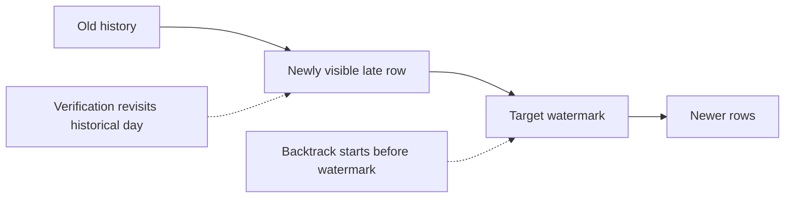

<style>
#btm {
  display: block;
  margin-left: auto;
  margin-right: auto;
}
@media screen and (max-width: 76.1875em) {
  #btm {
    width: 100%;
  }
}
@media screen and (min-width: 76.1875em) {
  #btm {
    width: 70%;
  }
}
</style>

# 📥 Syncing

!!! abstract inline end "Want to read more?"
    I wrote my [master's thesis](https://tigerprints.clemson.edu/all_theses/3647/) on comparing syncing strategies.

Meerschaum syncs time-series data in three ETL steps: **fetch**, **filter**, and **upsert**. When writing plugins, you only need to return data between `begin` and `end` bounds — Meerschaum handles the rest.

## Syncing Stages

- **Fetch** (*Extract & Transform*): Requests rows newer than the previous sync time, minus a backtracking window.

??? example "Example `fetch` query"

    === "SQL"
        ```sql
        WITH "definition" AS (
          SELECT datetime, id, value
          FROM remote_table
        )
        SELECT "datetime", "id", "value"
        FROM "definition"
        WHERE "datetime" >= '2021-06-23 14:52:00'
        ```

    === "Python"
        ```python
        sync_time = pipe.get_sync_time()
        fetch(begin=sync_time)
        ```

- **Filter** (*Remove duplicates*): Compares fetched rows against existing target rows and keeps only new or changed rows.

!!! tip inline end "Skip filtering"
    Skip the filter stage with `--skip-check-existing` or `pipe.sync(check_existing=False)`.

??? example "Example `filter` query"

    === "SQL"
        ```sql
        SELECT "new"."datetime", "new"."id", "new"."value"
        FROM "new"
        LEFT JOIN "old"
          ON "new"."id" = "old"."id"
         AND "new"."datetime" = "old"."datetime"
        WHERE "old"."datetime" IS NULL
          AND "old"."id" IS NULL
        ```

    === "Pandas"
        ```python
        joined_df = pd.merge(
            new_df.fillna(pd.NA),
            old_df.fillna(pd.NA),
            how='left',
            on=None,
            indicator=True,
        )
        delta_df = joined_df[joined_df['_merge'] == 'left_only']
        ```

- **Upsert** (*Load*): Writes the delta rows into the target table via the pipe's [instance connector](/reference/connectors/#instances-and-repositories). With [`upsert`](/reference/pipes/parameters/#upsert) enabled, inserts and updates run in a single statement.

??? example "Example `upsert` queries"

    === "Inserts"
        ```sql
        COPY target_table (datetime, id, value)
        FROM STDIN WITH CSV
        ```

    === "Upserts"
        ```sql
        INSERT INTO target_table (datetime, id, value)
        SELECT datetime, id, value
        FROM patch_table
        ON CONFLICT (datetime, id)
          DO UPDATE SET value = EXCLUDED.value
        ```

## Backtracking

When data arrives late or a pipe tracks multiple streams (an `id` column), fetching strictly after the newest timestamp misses lagging series.

The **backtrack interval** (default `1440` minutes) overlaps each sync with the previous window:


Configure it under `fetch:backtrack_minutes`:

=== "`mrsm edit pipes`"

    ```yaml
    fetch:
      backtrack_minutes: 1440
    ```

=== "Python"

    ```python
    import meerschaum as mrsm

    pipe = mrsm.Pipe(
        'plugin:noaa', 'weather',
        instance='sql:local',
        parameters={
            'fetch': {'backtrack_minutes': 1440},
            'noaa': {'stations': ['KGMU', 'KCEU']},
        },
    )
    ```

## Immutable synchronization strategies

Set `sync.immutable: true` when rows are permanent after insertion (new rows may still arrive late). Configure a non-null `datetime` column, a stable unique row key, and optionally an `id` column for multiple series.

```yaml
columns:
  datetime: ts
  id: sensor_id
sync:
  immutable: true
  strategy: unbounded-simple
```

Only `backtrack` (default) and `naive` work on mutable pipes (`sync.immutable: false`); all other strategies require `sync.immutable: true`. Normal deduplication still applies, and none of these strategies delete rows.



### Incremental strategies

| Strategy | Rows requested | Notes |
| --- | --- | --- |
| `backtrack` | Newest target timestamp minus `fetch.backtrack_minutes`. | Default; supports mutable pipes. |
| `simple` | From the newest target timestamp onward (inclusive). | Late rows older than the watermark need verification. |
| `naive` | Entire source query, merged by row key. | Picks up edits anywhere; works on mutable pipes. |
| `slow-id` | From the oldest per-ID target watermark. | A stalled series widens reads for all known IDs. |
| `append` | `UNION ALL` of per-ID queries at each ID's watermark. | Direct Postgres-compatible connectors; ≤ 256 IDs. |
| `join` | Left-joins source to a `VALUES` table of per-ID watermarks. | Direct Postgres-compatible connectors; ≤ 256 IDs. |

The per-ID strategies (`slow-id`, `append`, `join`) pull all rows for brand-new IDs and require consistent text or integer ID types on both direct PostgreSQL-compatible connectors.

### Historical verification

| Strategy | How it finds gaps | Requirements |
| --- | --- | --- |
| `iterative-simple` | Compares exact source vs. target row counts per UTC day and fetches mismatches. | Any SQL connector. |
| `daily-row-count` | Compares grouped UTC daily counts on both sides and fetches mismatches. | PostgreSQL, SQLite, or DuckDB on both sides. |
| `binary-search` | Counts a window, then bisects unequal ranges to isolate missing rows. | Any SQL connector. |
| `iterative-cpisync` | Uses characteristic polynomial interpolation to fetch sparse missing timestamps per series. | PostgreSQL-compatible connectors; unique microsecond timestamps per ID. |

By default, verification strategies inspect the last 30 UTC days (`sync.lookback_days`). Prefix any strategy with `unbounded-` (e.g. `unbounded-simple`, alias for `unbounded-iterative-simple`) to cover full source history while pruning equal-count ranges.

Count-based strategies assume the target is a subset of an immutable source (equal counts hide in-place edits). For `iterative-cpisync`, days exceeding 1,024 source rows or 16 missing rows fall back to a regular window fetch ([thesis details](https://meerschaum.io/files/pdf/thesis.pdf#page=57)).

### Monthly correction

Monthly strategies run `simple` incrementally and perform a full-history verification on the first automatic run of each UTC calendar month, checkpointing on success:

- `simple-monthly-naive`
- `simple-monthly-iterative-simple`
- `simple-monthly-daily-row-count`
- `simple-monthly-binary-search`
- `simple-monthly-iterative-cpisync`

Monthly strategies require a registered pipe on a direct SQL instance and an unfiltered automatic sync. All strategies apply only to automatic `Pipe.sync()` / `mrsm sync pipes` fetches without explicit `begin`/`end` bounds (merge mode with existing-row checks enabled).

## Replacing a window

Normal syncs merge rows and leave unlisted rows untouched. Pass `replace=True` (or `--replace`) when incoming data is authoritative for `[begin, end)`: existing rows in that window are deleted and new rows inserted **in one transaction**.

=== "Python"

    ```python
    from datetime import datetime

    pipe.sync(df, begin=datetime(2024, 1, 1), end=datetime(2024, 1, 2), replace=True)
    # 🎉 Replaced 96 rows with 94 rows.
    ```

=== "Bash"

    ```bash
    mrsm sync pipes -c sql:main -m weather --begin 2024-01-01 --end 2024-01-02 --replace
    ```

=== "`mrsm edit pipes`"

    ```yaml
    fetch:
      replace: true
    ```

Window selection rules:

- **With data (`pipe.sync(df, replace=True)`)**: Uses explicit `begin`/`end`; omitted bounds are inferred from `df`'s min/max datetimes. Out-of-window rows are skipped, and `params` narrows the replaced slice.
- **Without data (fetch)**: Replaces the fetch's `[begin, end)` window (or each chunk's window). Set [`fetch:replace: true`](/reference/pipes/parameters/#fetchreplace) to make every fetch replacing.
- **Empty frame**: Clears `[begin, end)` when both bounds are passed; refused if both are omitted (HTTP API returns `400`).
- **No `datetime` column**: Replaces the entire table (filtered by `params`).
- **Pipelines & instances**: Marks the window changed so downstream [Pipeline](/reference/pipelines/) children re-sync it. SQL and `api:` instances replace atomically in one transaction; Valkey clears then writes.

## Verification Syncs

Re-sync a pipe's historical interval in chunks to backfill gaps with `verify pipes` or `sync pipes --verify`:

=== "Bash"

    ```bash
    mrsm verify pipes
    # or
    mrsm sync pipes --verify
    ```

=== "Python"

    ```python
    pipe.verify()
    # or
    pipe.sync(verify=True)
    ```

Tune chunk size (`verify:chunk_minutes`, default `43200`) and default lookback bound (`verify:bound_days`, default `366`):

=== "`mrsm edit pipes`"

    ```yaml
    verify:
      chunk_minutes: 43200
      bound_days: 366
    ```

=== "Python"

    ```python
    pipe = mrsm.Pipe(
        'plugin:noaa', 'weather',
        instance='sql:local',
        parameters={
            'verify': {'chunk_minutes': 43200, 'bound_days': 366},
        },
    )
    ```

## Deduplication Syncs

If an upstream source emits duplicate rows, run `deduplicate pipes` to detect, clear, and re-sync affected chunks.

!!! note inline end ""
    Requires an instance connector implementing `clear_pipe()` or `deduplicate_pipe()`.

=== "Bash"

    ```bash
    mrsm deduplicate pipes
    # or
    mrsm sync pipes --deduplicate
    ```

=== "Python"

    ```python
    pipe.deduplicate()
    # or
    pipe.sync(deduplicate=True)
    ```

!!! tip "Combine `--verify` and `--deduplicate`"
    Run `mrsm sync pipes --verify --deduplicate` to verify and deduplicate in a single pass.
